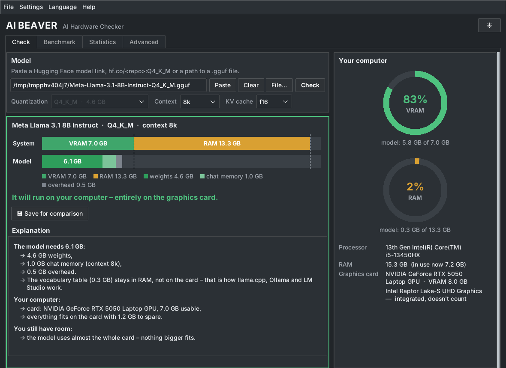
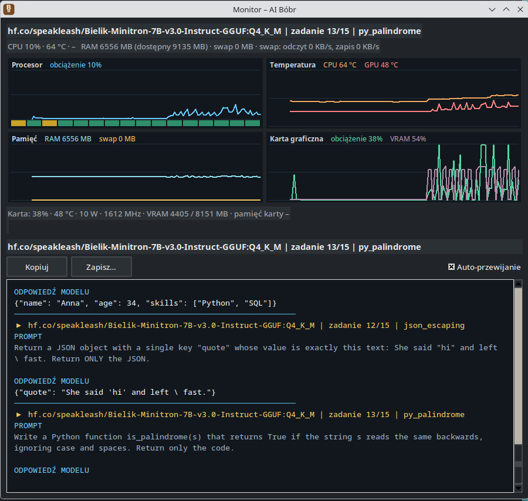

[](assets/banner.jpg)

# AI Bóbr (AI BEAVER)

**AI Hardware Checker** – will this local LLM run on my PC, and how fast?
*Czy ten lokalny model językowy pójdzie na moim komputerze i jak szybko?*

### ⬇️ [Download the latest version for Windows](https://github.com/DarkZachi83/Bobr/releases/latest) – no Python installation needed.
*⬇️ [Pobierz najnowszą wersję dla Windows](https://github.com/DarkZachi83/Bobr/releases/latest) – bez instalowania Pythona.*

**[English](#english) · [Polski](#polski)**

> ⭐ **Like it? Leave a star** – it means a lot to the author and helps further work.
> ⭐ **Podoba się? Zostaw gwiazdkę** – to dla autora dużo znaczy i pomaga w dalszych pracach.

<p align="center"></p>
<p align="center"><sub>Llama 3.1 8B (Q4_K_M) on a laptop with an RTX 5050 8 GB: fits, but with a small margin. / Llama 3.1 8B na laptopie z RTX 5050 8 GB: mieści się, ale na styk.</sub></p>

<p align="center"></p>
<p align="center"><sub>Benchmark on your own computer: the Monitor window shows CPU, temperatures, memory and the GPU live, with the model's answer. / Benchmark na Twoim komputerze: okno Monitor pokazuje na żywo procesor, temperatury, pamięć i kartę oraz odpowiedź modelu.</sub></p>

---

## English

### What is it?

You want to try a model in Ollama, LM Studio or Jan, and you hit a wall of terms: VRAM,
Q4_K_M, context, KV cache, MoE. AI Bóbr answers one question for **one specific model**:
does it fit, and where?

- **Pick a model:** a Hugging Face link, `hf.co/<repo>:Q4_K_M` (the same form as `ollama run`),
  a local `.gguf` file, a model from the **Benchmark** tab list (Ollama, LM Studio, …) or the
  numbers entered by hand (**File → Enter model data manually…**). Context and KV cache sit right
  next to the quantization.
- **It scans your PC:** CPU, RAM and graphics cards (NVIDIA, AMD, Intel; Linux and Windows).
- **You get a memory bar:** your fast VRAM and slower RAM against what the model needs –
  weights, chat memory (KV cache) and overhead.
  - 🟢 everything on the graphics card – full speed,
  - 🟡 part of it in RAM – slower (with the percentage that stays on the card),
  - 🔴 doesn't fit at all – and how much is missing.
- **Two dials** show how much of your graphics card and RAM the model will take.
- **"Explanation"** (always visible under the result) tells you in plain words what uses the
  memory and **what you can do**: a quantization, a context length or a KV-cache setting that
  actually changes the verdict, or a smaller model from the built-in list that fits.

It reads only the header of the model file – a few MB, not gigabytes – so checking a 40 GB
model from Hugging Face takes seconds. Nothing is downloaded or installed.

The window has six tabs – **Check**, **Benchmark**, **Quality**, **Diagnostics**, **Statistics**, **Advanced**
(the same model on hardware you type in: "what if I had a 16 GB card?") – and a **dark or light theme** (☀/☾ icon or
Settings → Theme). The language is in its own **Language** menu.

### Quick start

**Windows:** download `AI-Bobr.exe` from [the latest release](https://github.com/DarkZachi83/Bobr/releases/latest)
and run it. The file isn't code-signed, so Windows SmartScreen may show
*"Windows protected your PC"* – click **More info → Run anyway**. `AI-Bobr-cli.exe` is the
same program for the command line.

**Linux** (and Windows from source) – Python 3.10+ with tkinter
(Arch: `pacman -S python tk`, Debian/Ubuntu: `apt install python3-tk`):

```
git clone https://github.com/DarkZachi83/Bobr.git && cd Bobr
pip install -r requirements.txt        # psutil; optional: nvidia-ml-py, ttkbootstrap (window theme)
python main.py                          # window
```

**macOS:** not supported yet – the program starts, but you have to enter RAM and VRAM by hand
(Advanced tab). Apple Silicon's unified memory needs its own rules, and we can't test them yet.

### Text mode

```
python main.py --cli hf.co/bartowski/Meta-Llama-3.1-8B-Instruct-GGUF:Q4_K_M --explain
python main.py --cli ~/models/qwen3-14b-Q4_K_M.gguf --context 16k
python main.py --cli <model> --vram 16 --ram 32      # "what if I buy a 16 GB card?"
python main.py --help
```

```
  System [=================---------------------------------]
  Model  [###########+++:                                   ]
  = VRAM 7.0 GB  - RAM 13.3 GB  # weights 4.6 GB  + chat memory 1.0 GB  : overhead 0.5 GB

>> It will run on your computer – entirely on the graphics card.
!  Small margin – a longer context or other programs may exceed the memory.
```

### How the memory is counted

```
needed = weights + KV cache + overhead
KV cache = 2 × layers × KV heads × head size × context × bytes per element
```

- **Weights:** the real file size (Hugging Face or your `.gguf`); for hand-entered models,
  bits per weight from `data/quants.json` (marked as an estimate).
- **KV cache:** from the model's architecture; grows with context. 8B at 8k ≈ 1 GB, at 32k ≈ 4 GB.
- **Usable memory:** VRAM minus 1 GB per card, RAM minus 2 GB (Linux) / 4 GB (Windows) for the system.
  Changeable on the Advanced tab.
- **MoE models** (e.g. Qwen3-30B-A3B) must fit entirely, but use only part of the parameters per
  word, so they stay usable even partly in RAM. The program then suggests LM Studio's
  *"Force Model Expert Weights onto CPU"* or llama.cpp's `--cpu-moe`.

### Limits – read before you trust the number

- It's a **calculation, not a measurement**. The runtime overhead (0.5 GB) was calibrated on real
  runs (Ollama, RTX 5050 8 GB, models 3–14B: 17/17 verdicts right, never below nvidia-smi); much
  bigger models may need more. Like llama.cpp, the vocabulary table is counted in RAM, not on the card.
- **Speech models** (Orpheus, OuteTTS) are recognised by their audio tokens; Orpheus's audio decoder
  (SNAC) was measured at 0.22 GB, OuteTTS's is still an estimate.
- **Sliding-window models** (Gemma 3, gpt-oss) keep only recent tokens in most layers – this is
  counted for known architectures (llama.cpp rules); unknown ones get the full, safer estimate.
- A card with a lot of VRAM isn't always usable: very old NVIDIA cards, older drivers, and AMD/Intel
  cards that depend on the runtime get a warning next to the bar.
- Windows: the current VRAM usage of AMD/Intel cards isn't shown (it doesn't affect the verdict).

### Image models

Single-file checkpoints (`.safetensors` – SD 1.5, SDXL, Illustrious, Pony), diffusers folders
and repositories, and FLUX/SD 3 (also as GGUF) are checked by **the peak of the heaviest stage**
(prompt encoding → drawing → decoding), because Forge, ComfyUI and SD.Next move parts between RAM
and the card. Native resolution by default, `--resolution 1024x768` / `--batch 2` to change.
The bar has three rows: **System**, **Peak** and **All at once**.

- **SDXL and SD 1.5 – measured** in Forge-neo (RTX 5050 8 GB, 512–1280 px): predictions within ~0.1 GB.
- **FLUX and SD 3 – still an estimate.** FLUX assumes the T5 text encoder in FP8. The tool warns
  when RAM may run out while loading (Forge reads all parts into RAM first) and when a GGUF model
  needs `--reserve-vram 2` in Forge-neo.
- Below the model's native resolution quality drops noticeably – the tool says so when it
  suggests a smaller image.

### Compare models

Click **Save for comparison** under a result to keep the model with its settings. The **Statistics**
tab shows one table with **Text / Image / Audio** filter buttons – up to 10 saved models per group –
compared live on this computer: today's verdict, relative speed (★ fastest, ▼ slowest), the largest
context or image that fits entirely on the card, the best quantization that fits, headroom, size and
whether you already have it on disk. **Hugging Face data** (on request): downloads in the last 30 days,
likes, last update and license – with a warning for non-commercial or gated models.
Under the table: how many models run (green / yellow / red), the fastest, the slowest and the most
popular one, and the top 10 by Hugging Face downloads. Double-click opens a model again with the
same settings. Everything stays in a file on your computer.

### Benchmark – Zacharski tests

The **Benchmark** tab answers two practical questions: **will this model run on my computer, and how
fast?** Tick models installed in **Ollama**, choose 1, 3 or 5 runs and the long-context lengths
(1k and 8k, 32k on request), and press Start. Models are measured one at a time; models that won't
fit are skipped.

**What happens before every run:** the previous model is released (confirmed by Ollama) and AI Bóbr
checks that GPU memory is back to where it was; it waits until the CPU and GPU temperature stop
changing (at most 1 °C in 30 s – if it takes longer than 5 minutes, you decide whether to start
anyway, and the result gets a warning); then it records a 10-second **baseline** of the idle computer.

**The test:** 15 short tasks (Polish, JSON, Python code) at 2k context. Before each task the model is
released and loaded again, so no task reuses the prompt memory of the previous one. **We rate speed,
not the content of the answers** – answers are saved so you can read them on the **Answers** tab, but
nothing is graded. What is checked is the measurement itself: the number of generated tokens, the
generation time and execution errors.

**The verdict** – 🟢 Fast, 🔵 Usable, 🟡 Slow, 🔴 Too slow – is the worse of two ratings:

| | 🟢 Fast | 🔵 Usable | 🟡 Slow | 🔴 Too slow |
|---|---|---|---|---|
| Generation | ≥ 30 tok/s | 15–30 tok/s | 6–15 tok/s | < 6 tok/s |
| Time to first token (median) | ≤ 1 s | 1–3 s | 3–8 s | > 8 s |

Next to the verdict you always see its basis, e.g. *"61.2 tok/s from 578 tokens in 9.4 s"*. Generation
is a weighted mean (all tokens ÷ all generation time); the time to first token is measured by the
program itself, not taken from the engine. The thresholds can be changed in the settings file
(`bench_thresholds`); every result keeps the thresholds it was rated with.

**Long context** is a separate section and does not change the verdict. What counts is the real length
of the input, not the configured context size: AI Bóbr fits the text to the model's tokenizer (input
≈ 90 % of the context, room left for the answer) and measures prompt processing, generation *after*
the long input and the real time to first token. Example from the author's laptop (RTX 4060 8 GB,
Bielik-Minitron 7B Q4_K_M): generation 56 tok/s after 1k, 45 tok/s after 8k; at 8k the first token comes
after about 4 s – fine for short questions, noticeable when you paste a long document.

**Monitor** – a separate window opened with the test: phase, CPU load per thread, CPU and GPU
temperature, RAM and swap, GPU load, power, clock and VRAM, the reason the GPU limits its clock, and the
model's answer as it is written. Closing it only hides it.

**Results and history.** Double-click a result for details (all 15 tasks, the long context, the
baseline, the thresholds). The **History** tab lists earlier sessions with the verdict on the test day
and, optionally, *by current thresholds* (shown only where it differs). Sessions can be exported to a
folder (`werdykt.csv`, `zadania.csv`, `dlugi_kontekst.csv`, `telemetria.csv`, `manifest.json`; exact
values, a missing reading is an empty cell, never 0) or deleted. Results from versions before 0.9 stay
untouched in **Archive (before 0.9)**. Everything is stored on your computer (`benchmarks.sqlite`; a
backup is made before the database is upgraded). Detailed telemetry can be kept for 30–365 days or
forever (`telemetry_retention_days`); results and verdicts are always kept.

**How to read it.** A single run is a performance sample under these conditions, not proof of
stability. Three or five runs show the spread (e.g. *61.2–61.5 tok/s*) – a measure of spread, not
proof of repeatability. Close heavy programs and plug in the laptop before testing.

**What the Monitor can read on your system:**

| | Linux | Windows |
|---|---|---|
| CPU load (total and per thread), RAM, swap | ✓ | ✓ |
| CPU temperature | ✓ (coretemp, k10temp) | ✗ not available |
| CPU power | only with access to RAPL (usually root) | ✗ not available |
| Swap activity (in/out per second) | ✓ | ✗ shown as *"Swap activity measurement unavailable"* |
| NVIDIA GPU: load, temperature, power, clock, VRAM, clock limit reason | ✓ | ✓ |
| GPU memory temperature | usually not reported by consumer cards | the same |

A missing sensor never stops the test: temperature stabilisation is skipped when no temperature is
available, and the missing value is recorded as "no data", not as zero.

[](docs/img/benchmark-monitor.png)

*The **Monitor** window during a benchmark: CPU load per thread, CPU and GPU temperature, RAM and swap,
GPU load and VRAM, and the model's answer as it is written.*

### Quality – what is the model good for

The **Quality** tab answers the third question: **what is this model good for?** Two standard tests,
15 tasks each (5 easy, 5 medium, 5 hard):

- **Humanities test** (in Polish): spelling and diacritics, inflection, numerals, verb aspect,
  punctuation, sentence transformation, language knowledge.
- **Science test** (in Polish **and** in English): arithmetic, percentages and units, logic, JSON,
  Python code. With the English version the window shows the question in Polish underneath – the model
  does not see it. The difference between the two versions shows how much the model loses in Polish.

**How it is graded.** Every task has one checkable answer and is graded by plain code – never by another
model ("a judge" is a language model too, with the same repeatability problems). Each answer gets two
separate marks: **correct** and **format followed**. A correct answer wrapped in ```json, preceded by
"Here is the code:" or written as a worked solution ("240 × 0.85 = 204") counts as correct, with a
"format not followed" note; if the answer cannot be read unambiguously, it is not passed. Small
differences are normalised (a full stop at the end, quotes around the answer, 24 = 24.0 = 24,0), but
diacritics and commas inside a sentence always count.

**Python code from the model is untrusted.** It runs only on Linux, in a **bubblewrap** sandbox: no
network, no access to your home folder, a read-only system, memory, CPU-time and process limits. A
self-test checks the isolation first; if anything is not blocked – and always on Windows – the code is
**not run**: you see it and grade it yourself, and until then the task counts as "not graded" (the result
shows the coverage, e.g. "12/12 graded · coverage 12/15"). On Arch: `sudo pacman -S bubblewrap`.

**Every task starts from scratch** (the model is released and loaded again), like in the benchmark.
One attempt per task by default; three attempts (passed at 2 of 3) show whether the model answers the
same way every time – a check of stability, not 45 tasks.

**The result**: each test separately, as fractions per category and difficulty level, plus a label that
speaks only about these tests, e.g. *"In these tests it did better on text tasks (12/15 vs 9/15)"* or
*"…did similarly in both"*. Fifteen tasks are a short indicative test, not a verdict on the model's
general abilities. Bielik-Minitron 7B on the author's laptop: humanities 11/15, science 12/15 (Polish).
Results go to the **History** tab (details, export to a folder with CSV files and `manifest.json`,
delete) and do not affect the speed verdict.

**Your own tests – the test editor.** *Settings → Test editor…* (or the button in the Quality tab) opens a
window where you write your own tests: tasks, difficulty, category and how the answer is checked – text,
number, fraction, a choice from options, JSON, Python code (function name plus `arguments -> result` cases)
or manual grading. Every error points at its task and field and blocks saving; a **grading preview** grades
a pasted answer with the same code as the test, without a model. The standard tests stay read-only – *Copy
as my test* gives you an editable copy. A test has a **main language** – any of about 40 (Lithuanian,
Korean, Chinese…) – and optionally an **English version**: most models learn mostly in English, so maths and
logic may go better in English than in your language (models trained heavily in one language – Qwen in
Chinese, Bielik in Polish – are the exception). Pick one version or both in the Quality tab; with both, the
result shows them side by side ("My test: KO 9/15, EN 12/15"). Language tasks (spelling, inflection) belong
only in the main language. A test file **never contains code** – only the model's code runs, in the sandbox
– so a test you import from someone else is safe. Changing a test that already has results raises its
version; History keeps its own copy of the tasks. Import and export as one `.json` file; tests live in
`~/.config/ai-bobr/quality/` (`%APPDATA%\AI-Bobr\quality\` on Windows). Your own tests are not part of the
humanities/science label.

### Diagnostics – what the model was really fed, and is the prompt fragile

Before you compare answers, pin down the input. The **Diagnostics** tab (also *Settings → Diagnostics*) has
two instruments; neither changes benchmark or quality results.

**Beginning token (BOS).** Many models expect a special token at the very start of the text. AI Bobr reads what
the model file expects – the `add_bos_token` flag **and** the chat template stored in the GGUF file (Ollama does
not show it, so it is read from the file header) – checks the Ollama template and sends two tiny queries without
a template, each from scratch, to count how many beginning tokens the model really gets. Result: *one* (fine),
*not used* (fine), **missing** or **double** (warning), or *unknown* (no warning). Example from the author's
machine: Bielik-Minitron pulled from `hf.co/…` has `add_bos_token = false`, but its GGUF template starts with
`{{bos_token}}` – Ollama's template drops it, so the model gets no beginning token at all; Gemma, Llama and
Qwen from the Ollama library are fine. The check runs by itself before the benchmark and the quality test (once
per model file). When a token is missing or doubled you choose what to run: **as Ollama serves it** (how the
model runs for you every day), **with the beginning token fixed** (AI Bobr creates a separate model in Ollama,
e.g. `bielik-minitron-7b-v3.0-instruct-gguf-bos:Q4_K_M` – the same file, no copy, a template with one beginning
token; the original stays untouched) or **both – comparison** (the result shows both side by side).

**Prompt fragility.** For every token of the answer the model also reports its runner-up. When the two are
nearly tied, a tiny change in the input can flip the answer. AI Bobr runs the tasks of a quality test (standard
or your own) with these probabilities, each from scratch, and marks every task **stable**, **fragile**
(gap below 0.10) or **tie** (below 0.02) – thresholds are yours to set. Only the answer and what precedes it
count; near-ties in an explanation after the answer are shown separately (and docstrings in code do not
count). The Quality tab then shows fragility next to each task, and in a *both – comparison* run every task
that changed gets a note decided at the **first step where the two answers differ**: **tie tipped over**
(a near-tie right there) or **real input difference** (the model was sure there) – with the step and the gap. The author's own BOS experiment turned out to sit on a fragile prompt – a good reason to measure
before concluding. Results go to History and export to CSV (`kruchosc.csv`, `token_poczatku.csv`,
`manifest.json`).

### Models on your disk

The **Benchmark** tab (or `--scan [FOLDER]`) lists the models you already have – from Ollama,
LM Studio, the Hugging Face cache, llama.cpp and GPT4All, or from any folder you pick (e.g. Stable
Diffusion or ComfyUI). It asks first, reads only file names, sizes and headers, never opens pickle
files (`.ckpt`) and sends nothing anywhere. The list is remembered, each model gets a verdict for
your computer, and a double-click checks it on the Check tab.

### Model list

Suggestions like *"the model X in Q4_K_M fits entirely"* come from `data/models/catalog.json`
(15 popular models from Llama 3.2 3B to Llama 3.3 70B). **Settings → Check for model list
updates** (or `--update-catalog`) downloads a newer list from this repository – the program
never connects to the internet on its own. The model you check always comes from your link or file.

### For developers

```
python -m unittest discover -s tests -t .     # GUI tests run when a display exists
python tools/try_source.py <link or .gguf>    # what the program reads from a model
python tools/try_detection.py [--json]        # what it detects on this PC (JSON = test profile)
python tools/calibrate.py                     # predictions vs. real memory use in Ollama
python tools/pomiar_predkosci.py <model> [--runs 3]   # speed benchmark from the terminal (separate database)
python tools/test_jakosci.py <model> [--attempts 3]   # quality tests from the terminal (separate database)
python tools/test_jakosci.py <model> --tests my_test/ko my_test/en   # your own test from the editor
python tools/sprawdz_bos.py [models]                  # beginning token (BOS) check, changes nothing in Ollama
python tools/kruchosc.py <model> [--test scisly_v1/pl] [--prompt "..."] [--steps]   # prompt fragility (logprobs)
python main.py --fake-hw tests/fake_hardware/windows_amd_rx7900xtx.json   # pretend hardware
python tools/build_catalog.py                 # rebuild the model list from catalog_sources.txt
python tools/build_exe.py                     # PyInstaller build (CI does this for v* tags)
```

Design decisions are in [docs/SPEC.md](docs/SPEC.md) (in Polish). Settings you change and your
Hugging Face token are stored outside the repository (`~/.config/ai-bobr/`,
`%APPDATA%\AI-Bobr\`).

### How it was made

AI Bóbr was designed by Rafał (idea, decisions, testing on real hardware) together with
**Claude (Anthropic)** as an AI pair-engineer (code, tests, documentation) – the same team as
[NIUCHACZ](https://github.com/DarkZachi83/NIUCHACZ-POST-Code-Sniffer-), whose architecture it follows.

### Like it?

If AI BEAVER saved you a download that would never have fit – **leave a ⭐ star** at the top of this
page. It means a lot to the author and helps decide what comes next (music models and more measurements
are on the way). Found a wrong verdict? [Open an issue](https://github.com/DarkZachi83/Bobr/issues)
with the model link and what your program really used – real measurements make the tool better for everyone.

### License

Copyright (C) 2026 Rafał Zacharski. [GNU General Public License v3.0](LICENSE) (GPL-3.0) from version 0.9.0. You may use, change and share
AI Bóbr freely; if you distribute a modified version or a program built on it, its source code must be
available under the same license. Versions up to and including 0.8.1 were released under the MIT
license and stay under it.

---

## Polski

### Co to jest?

Chcesz uruchomić model w Ollamie, LM Studio albo Janie i trafiasz na ścianę pojęć: VRAM,
Q4_K_M, kontekst, cache KV, MoE. AI Bóbr odpowiada na jedno pytanie dla **konkretnego modelu**:
czy się zmieści i gdzie?

- **Wskazujesz model:** link do Hugging Face, `hf.co/<repo>:Q4_K_M` (ta sama forma co w
  `ollama run`), plik `.gguf` z dysku, model z listy w zakładce **Benchmark** (Ollama, LM Studio…)
  albo dane wpisane ręcznie (**Plik → Wpisz dane modelu ręcznie…**). Kontekst i cache KV są tuż
  obok kwantyzacji.
- **Program sprawdza komputer:** procesor, RAM i karty graficzne (NVIDIA, AMD, Intel; Linux i Windows).
- **Dostajesz pasek pamięci:** szybki VRAM i wolniejszy RAM obok tego, czego potrzebuje model –
  wag, pamięci rozmowy (cache KV) i narzutu.
  - 🟢 całość w karcie graficznej – pełna prędkość,
  - 🟡 część w RAM – wolniej (z procentem, który zostaje w karcie),
  - 🔴 nie mieści się wcale – i ile brakuje.
- **Dwa mierniki** pokazują, jaką część karty graficznej i RAM zajmie model.
- **„Wyjaśnienie”** (zawsze widoczne pod wynikiem) mówi prostymi słowami, co zajmuje
  pamięć i **co możesz zrobić**: kwantyzację, długość kontekstu albo ustawienie cache KV, które
  naprawdę zmieniają werdykt, albo mniejszy model z wbudowanej listy, który się zmieści.

Program czyta tylko nagłówek pliku modelu – kilka MB, nie gigabajty – więc sprawdzenie modelu
40 GB z Hugging Face trwa kilka sekund. Nic nie jest pobierane ani instalowane.

Okno ma sześć zakładek – **Sprawdź**, **Benchmark**, **Jakość**, **Diagnostyka**, **Statystyka**, **Zaawansowane**
(ten sam model na sprzęcie, który wpiszesz: „co by było z kartą 16 GB?”) – i **styl ciemny albo jasny** (ikona ☀/☾
albo Ustawienia → Styl). Język zmienisz w osobnym menu **Język**.

### Szybki start

**Windows:** pobierz `AI-Bobr.exe` z [najnowszego wydania](https://github.com/DarkZachi83/Bobr/releases/latest)
i uruchom. Plik nie ma płatnego podpisu, więc Windows SmartScreen może pokazać
„System Windows ochronił ten komputer” – kliknij **Więcej informacji → Uruchom mimo to**.
`AI-Bobr-cli.exe` to ten sam program do wiersza poleceń.

**Linux** (i Windows ze źródeł) – Python 3.10+ z tkinterem
(Arch: `pacman -S python tk`, Debian/Ubuntu: `apt install python3-tk`):

```
git clone https://github.com/DarkZachi83/Bobr.git && cd Bobr
pip install -r requirements.txt        # psutil; opcjonalnie: nvidia-ml-py, ttkbootstrap (wygląd okna)
python main.py                          # okno
```

**macOS:** jeszcze nieobsługiwany – program się uruchomi, ale RAM i VRAM trzeba wpisać ręcznie
(zakładka Zaawansowane). Pamięć zunifikowana Apple Silicon wymaga własnych reguł, których na razie
nie możemy sprawdzić.

### Tryb tekstowy

```
python main.py --cli hf.co/bartowski/Meta-Llama-3.1-8B-Instruct-GGUF:Q4_K_M --explain
python main.py --cli ~/modele/qwen3-14b-Q4_K_M.gguf --context 16k
python main.py --cli <model> --vram 16 --ram 32      # „a gdybym kupił kartę 16 GB?”
python main.py --help
```

### Jak liczymy pamięć

```
potrzeba = wagi + cache KV + narzut
cache KV = 2 × warstwy × głowice KV × wymiar głowicy × kontekst × bajty na element
```

- **Wagi:** prawdziwy rozmiar pliku (z Hugging Face albo Twojego `.gguf`); przy wpisie ręcznym –
  bity na wagę z `data/quants.json` (oznaczone jako szacunek).
- **Cache KV:** z architektury modelu; rośnie z kontekstem. 8B przy 8k ≈ 1 GB, przy 32k ≈ 4 GB.
- **Pamięć użytkowa:** VRAM minus 1 GB na kartę, RAM minus 2 GB (Linux) / 4 GB (Windows) dla
  systemu. Do zmiany w zakładce Zaawansowane.
- **Modele MoE** (np. Qwen3-30B-A3B) muszą się zmieścić w całości, ale przy każdym słowie używają
  tylko części parametrów, więc częściowo w RAM nadal są używalne. Program podpowiada wtedy
  „Force Model Expert Weights onto CPU” w LM Studio albo `--cpu-moe` w llama.cpp.

### Ograniczenia – przeczytaj, zanim zaufasz liczbie

- To **obliczenie, a nie pomiar**. Narzut runtime'u (0,5 GB) skalibrowaliśmy na prawdziwych
  uruchomieniach (Ollama, RTX 5050 8 GB, modele 3–14B: 17/17 trafionych werdyktów, ani razu poniżej
  nvidia-smi); dużo większe modele mogą potrzebować więcej. Tablicę słownika liczymy – jak
  llama.cpp – w RAM, nie w karcie.
- **Modele mowy** (Orpheus, OuteTTS) program rozpoznaje po tokenach dźwięku; dekoder Orpheusa
  (SNAC) zmierzyliśmy – 0,22 GB, dla OuteTTS to na razie szacunek.
- **Modele z oknem przesuwnym** (Gemma 3, gpt-oss) trzymają w większości warstw tylko ostatnie
  tokeny – dla znanych architektur liczymy to według reguł llama.cpp, dla nieznanych pełny,
  bezpieczniejszy szacunek.
- Duży VRAM nie zawsze znaczy, że runtime go użyje: bardzo stare karty NVIDIA, starsze sterowniki
  i karty AMD/Intel zależne od runtime'u dostają ostrzeżenie obok paska.
- Windows: bieżące zajęcie VRAM kart AMD/Intel nie jest pokazywane (nie wpływa na werdykt).

### Modele obrazów

Pliki „wszystko w jednym” (`.safetensors` – SD 1.5, SDXL, Illustrious, Pony), foldery i repozytoria
diffusers oraz FLUX/SD 3 (także w GGUF) program ocenia po **szczycie najcięższego etapu**
(kodowanie opisu → rysowanie → dekodowanie), bo Forge, ComfyUI i SD.Next przenoszą części między RAM
a kartą. Domyślnie rozdzielczość natywna, zmiana: `--resolution 1024x768`, `--batch 2`. Pasek ma
trzy wiersze: **System**, **Szczyt** i **Naraz**.

- **SDXL i SD 1.5 – zmierzone** w Forge-neo (RTX 5050 8 GB, 512–1280 px): przewidywania z dokładnością ok. 0,1 GB.
- **FLUX i SD 3 – na razie szacunek.** Dla FLUX przyjmujemy koder tekstu T5 w FP8. Program ostrzega,
  gdy przy wczytywaniu może zabraknąć RAM (Forge najpierw czyta wszystkie części do RAM) i gdy model
  GGUF wymaga w Forge-neo `--reserve-vram 2`.
- Poniżej natywnej rozdzielczości modelu jakość wyraźnie spada – program mówi o tym, gdy podpowiada
  mniejszy obraz.

### Porównanie modeli

Przycisk **Zapisz do porównania** pod wynikiem zapamiętuje model razem z ustawieniami. Zakładka
**Statystyka** ma jedną tabelę z przyciskami filtrów **Tekst / Obraz / Dźwięk** – do 10 zapisanych modeli w grupie –
porównanych na bieżąco na tym komputerze: werdykt dziś, szybkość względna (★ najszybszy, ▼ najwolniejszy),
największy kontekst albo obraz w całości w karcie, najlepsza kwantyzacja w karcie, zapas, rozmiar i to,
czy model już masz na dysku. **Dane z Hugging Face** (na żądanie): pobrania z ostatnich 30 dni,
polubienia, data aktualizacji i licencja – z ostrzeżeniem przy licencji niekomercyjnej albo wymaganej
akceptacji warunków. Pod tabelą: ile modeli pójdzie (zielone / żółte / czerwone), najszybszy,
najwolniejszy i najpopularniejszy oraz 10 najczęściej pobieranych z Hugging Face. Dwuklik otwiera
model ponownie z tymi samymi ustawieniami. Wszystko zostaje w pliku na Twoim komputerze.

### Benchmark – testy Zacharskiego

Zakładka **Benchmark** odpowiada na dwa praktyczne pytania: **czy ten model uruchomi się na moim
komputerze i jak szybko będzie działał?** Zaznaczasz modele zainstalowane w **Ollamie**, wybierasz 1, 3
albo 5 przebiegów i długości długiego kontekstu (1k i 8k, 32k na życzenie), a potem klikasz Start.
Modele są mierzone po kolei; te, które się nie zmieszczą, są pomijane.

**Co dzieje się przed każdym przebiegiem:** poprzedni model jest zwalniany (Ollama to potwierdza), a AI
Bóbr sprawdza, czy pamięć karty wróciła do stanu sprzed testu; czeka, aż temperatura procesora i karty
przestanie się zmieniać (najwyżej 1 °C w 30 s – jeśli trwa to dłużej niż 5 minut, decydujesz, czy
zacząć mimo to, a wynik dostaje ostrzeżenie); potem zapisuje 10-sekundową **linię bazową** komputera
w spoczynku.

**Test:** 15 krótkich zadań (polszczyzna, JSON, kod w Pythonie) przy kontekście 2k. Przed każdym
zadaniem model jest zwalniany i wczytywany od nowa, więc żadne zadanie nie korzysta z pamięci promptu
poprzedniego. **Oceniamy prędkość, nie treść odpowiedzi** – odpowiedzi są zapisane i można je przeczytać
w zakładce **Odpowiedzi**, ale nic nie jest oceniane. Pilnujemy samego pomiaru: liczby wygenerowanych
tokenów, czasu generowania i błędów wykonania.

**Werdykt** – 🟢 Szybko, 🔵 Użytecznie, 🟡 Wolno, 🔴 Zbyt wolno – to gorsza z dwóch ocen:

| | 🟢 Szybko | 🔵 Użytecznie | 🟡 Wolno | 🔴 Zbyt wolno |
|---|---|---|---|---|
| Generowanie | ≥ 30 tok/s | 15–30 tok/s | 6–15 tok/s | < 6 tok/s |
| Czas do pierwszego tokenu (mediana) | ≤ 1 s | 1–3 s | 3–8 s | > 8 s |

Przy werdykcie zawsze widać jego podstawę, np. *„61,2 tok/s z 578 tokenów w 9,4 s”*. Generowanie to
średnia ważona (wszystkie tokeny ÷ cały czas generowania); czas do pierwszego tokenu mierzy sam
program, nie bierzemy go z silnika. Progi można zmienić w pliku ustawień (`bench_thresholds`); każdy
wynik pamięta progi, według których go oceniono.

**Długi kontekst** to osobna sekcja i nie zmienia werdyktu. Liczy się rzeczywista długość wejścia, nie
ustawiony rozmiar kontekstu: AI Bóbr dopasowuje tekst do tokenizatora modelu (wejście ≈ 90% kontekstu,
z miejscem na odpowiedź) i mierzy przetwarzanie promptu, generowanie *po* długim wejściu i rzeczywisty
czas do pierwszego tokenu. Przykład z laptopa autora (RTX 4060 8 GB, Bielik-Minitron 7B Q4_K_M):
generowanie 56 tok/s po 1k, 45 tok/s po 8k; przy 8k pierwszy token pojawia się po ok. 4 s – przy
krótkich pytaniach nie ma to znaczenia, przy wklejeniu długiego dokumentu czekanie jest odczuwalne.

**Monitor** – osobne okno otwierane razem z testem: faza, obciążenie procesora z podziałem na wątki,
temperatura CPU i GPU, RAM i swap, obciążenie, moc, taktowanie i VRAM karty, powód ograniczenia
taktowania i odpowiedź modelu pisana na żywo. Zamknięcie tylko je chowa.

**Wyniki i historia.** Dwuklik na wyniku pokazuje szczegóły (wszystkie 15 zadań, długi kontekst, linię
bazową, progi). Zakładka **Historia** pokazuje wcześniejsze sesje z werdyktem z dnia testu i – na
życzenie – *według obecnych progów* (tylko tam, gdzie wychodzi inny). Sesję można wyeksportować do
folderu (`werdykt.csv`, `zadania.csv`, `dlugi_kontekst.csv`, `telemetria.csv`, `manifest.json`; wartości
bez zaokrągleń, brak odczytu to pusta komórka, nigdy 0) albo usunąć. Wyniki z wersji sprzed 0.9 zostają
bez zmian w **Archiwum (przed 0.9)**. Wszystko jest zapisane na Twoim komputerze (`benchmarks.sqlite`;
przed aktualizacją bazy program robi jej kopię). Szczegółową telemetrię można trzymać 30–365 dni albo
bezterminowo (`telemetry_retention_days`); wyniki i werdykty zostają zawsze.

**Jak to czytać.** Pojedynczy przebieg to próbka wydajności w tych warunkach, nie dowód stabilności.
Trzy albo pięć przebiegów pokazuje rozrzut (np. *61,2–61,5 tok/s*) – to pomiar rozrzutu, nie dowód
powtarzalności. Przed testem zamknij ciężkie programy i podłącz laptopa do zasilacza.

**Co Monitor potrafi odczytać w Twoim systemie:**

| | Linux | Windows |
|---|---|---|
| Obciążenie procesora (całe i na wątek), RAM, swap | ✓ | ✓ |
| Temperatura procesora | ✓ (coretemp, k10temp) | ✗ niedostępna |
| Moc procesora | tylko z dostępem do RAPL (zwykle root) | ✗ niedostępna |
| Aktywność swap (odczyt/zapis na sekundę) | ✓ | ✗ widać *„Pomiar aktywności swap niedostępny”* |
| Karta NVIDIA: obciążenie, temperatura, moc, taktowanie, VRAM, powód ograniczenia taktowania | ✓ | ✓ |
| Temperatura pamięci karty | karty konsumenckie zwykle jej nie podają | tak samo |

Brak czujnika nigdy nie zatrzymuje testu: stabilizacja temperatury jest pomijana, gdy żadna temperatura
nie jest dostępna, a brakująca wartość jest zapisana jako „brak danych”, nie jako zero.

[](docs/img/benchmark-monitor.png)

*Okno **Monitor** w trakcie benchmarku: obciążenie procesora z podziałem na wątki, temperatura CPU i GPU,
RAM i swap, obciążenie karty i VRAM oraz odpowiedź modelu pisana na żywo.*

### Jakość – do czego model się nadaje

Zakładka **Jakość** odpowiada na trzecie pytanie: **do czego ten model się nadaje?** Dwa testy
standardowe, po 15 zadań (5 łatwych, 5 średnich, 5 trudnych):

- **Test humanistyczny** (po polsku): ortografia i znaki diakrytyczne, fleksja, liczebniki, aspekt
  czasownika, interpunkcja, przekształcanie zdań, wiedza o języku.
- **Test ścisły** (po polsku **i** po angielsku): arytmetyka, procenty i jednostki, logika, JSON, kod
  w Pythonie. Przy wersji angielskiej okno pokazuje pod spodem pytanie po polsku – model go nie widzi.
  Różnica między wersjami pokazuje, ile model traci na polszczyźnie.

**Jak oceniamy.** Każde zadanie ma jedną sprawdzalną odpowiedź i ocenia je zwykły kod – nigdy inny model
(„sędzia” to też model językowy, z tymi samymi problemami z powtarzalnością). Każda odpowiedź dostaje dwie
osobne oceny: **poprawność** i **zgodność z formatem**. Poprawna odpowiedź w otoczce ```json, poprzedzona
„Oto kod:” albo zapisana z obliczeniami („240 × 0,85 = 204”) jest zaliczona, z dopiskiem „nie zachowano
wymaganego formatu”; odpowiedź, której nie da się jednoznacznie odczytać, nie jest zaliczona. Drobne
różnice są normalizowane (kropka na końcu, cudzysłów wokół odpowiedzi, 24 = 24.0 = 24,0), ale znaki
diakrytyczne i przecinki w środku zdania liczą się zawsze.

**Kod Pythona od modelu jest niezaufany.** Uruchamia się tylko na Linuksie, w piaskownicy **bubblewrap**:
bez sieci, bez dostępu do Twojego katalogu domowego, system tylko do odczytu, limity pamięci, czasu
procesora i procesów. Najpierw test kontrolny sprawdza izolację; jeśli cokolwiek nie jest zablokowane –
i zawsze na Windowsie – kod **nie jest uruchamiany**: widzisz go i oceniasz sam, a do tego czasu zadanie
jest „nieocenione” (wynik pokazuje pokrycie, np. „12/12 ocenionych · pokrycie 12/15”). Na Arch:
`sudo pacman -S bubblewrap`.

**Każde zadanie od zera** (model zwolniony i wczytany od nowa), jak w benchmarku. Domyślnie jedna próba
na zadanie; trzy próby (zaliczone przy 2 z 3) pokazują, czy model odpowiada za każdym razem tak samo – to
sprawdzenie stabilności, a nie 45 zadań.

**Wynik**: każdy test osobno, w ułamkach według kategorii i poziomów trudności, oraz etykieta, która mówi
tylko o tych testach, np. *„W tych testach lepiej wypadł w zadaniach tekstowych (12/15 wobec 9/15)”* albo
*„…wypadł podobnie w obu”*. Piętnaście zadań to krótki test orientacyjny, a nie werdykt o ogólnych
zdolnościach modelu. Bielik-Minitron 7B na laptopie autora: humanistyczny 11/15, ścisły 12/15 (po
polsku). Wyniki trafiają do zakładki **Historia** (szczegóły, eksport do folderu z plikami CSV i
`manifest.json`, usuwanie) i nie wpływają na werdykt prędkości.

**Własne testy – edytor testów.** *Ustawienia → Edytor testów…* (albo przycisk w zakładce Jakość) otwiera
okno, w którym piszesz własne testy: zadania, poziom trudności, kategorię i sposób sprawdzenia odpowiedzi –
tekst, liczba, ułamek, wybór z opcji, JSON, kod Pythona (nazwa funkcji i przypadki `argumenty -> wynik`)
albo ocena ręczna. Każdy błąd wskazuje zadanie i pole i blokuje zapis; **podgląd oceny** ocenia wklejoną
odpowiedź tym samym kodem co test, bez modelu. Testy standardowe są tylko do odczytu – *Utwórz kopię jako
mój test* daje kopię do edycji. Test ma **język główny** – dowolny z ok. 40 (litewski, koreański,
chiński…) – i opcjonalnie **wersję angielską**: większość modeli uczy się głównie po angielsku, więc
matematyka i logika mogą wypaść lepiej po angielsku niż w Twoim języku (wyjątek to modele uczone mocno
w jednym języku – Qwen po chińsku, Bielik po polsku). W zakładce Jakość wybierasz jedną wersję albo obie;
przy obu wynik pokazuje je obok siebie („Mój test: KO 9/15, EN 12/15”). Zadania językowe (ortografia,
fleksja) mają sens tylko w języku głównym. Plik testu **nigdy nie zawiera kodu** – uruchamiany jest tylko
kod modelu, w piaskownicy – więc test zaimportowany od kogoś innego jest bezpieczny. Zmiana testu, który ma
już wyniki, podnosi jego wersję; Historia ma własną kopię zadań. Import i eksport – jeden plik `.json`;
testy leżą w `~/.config/ai-bobr/quality/` (na Windowsie `%APPDATA%\AI-Bobr\quality\`). Własne testy nie
wchodzą do etykiety humanistyczny/ścisły.

### Diagnostyka – co model naprawdę dostał i czy prompt jest kruchy

Zanim porównasz odpowiedzi, ustal wejście. Zakładka **Diagnostyka** (też *Ustawienia → Diagnostyka*) ma dwa
narzędzia; żadne nie zmienia wyników benchmarku ani testu jakości.

**Token początku (BOS).** Wiele modeli oczekuje specjalnego tokenu na samym początku tekstu. AI Bóbr odczytuje,
czego oczekuje plik modelu – flagę `add_bos_token` **i** szablon czatu zapisany w pliku GGUF (Ollama go nie
pokazuje, więc czytamy nagłówek pliku) – sprawdza szablon Ollamy i wysyła dwa malutkie zapytania bez szablonu,
każde od zera, żeby policzyć, ile tokenów początku model naprawdę dostaje. Wynik: *jeden* (w porządku), *model
go nie używa* (w porządku), **brak** albo **podwójny** (ostrzeżenie), *nie wiadomo* (bez ostrzeżenia). Przykład
z komputera autora: Bielik-Minitron pobrany z `hf.co/…` ma `add_bos_token = false`, ale jego szablon GGUF
zaczyna się od `{{bos_token}}` – szablon Ollamy go gubi, więc model nie dostaje tokenu początku wcale; Gemma,
Llama i Qwen z biblioteki Ollamy są w porządku. Sprawdzenie uruchamia się samo przed benchmarkiem i testem
jakości (raz na plik modelu). Przy braku albo podwójnym tokenie wybierasz, co uruchomić: **jak podaje Ollama**
(tak model działa u Ciebie na co dzień), **z poprawionym tokenem początku** (AI Bóbr tworzy w Ollamie osobny
model, np. `bielik-minitron-7b-v3.0-instruct-gguf-bos:Q4_K_M` – ten sam plik, bez kopiowania, szablon z jednym
tokenem początku; oryginał zostaje nietknięty) albo **oba – porównanie** (wynik pokazuje oba obok siebie).

**Kruchość promptu.** Przy każdym tokenie odpowiedzi model podaje też drugiego kandydata. Gdy obaj są prawie
na remis, drobna zmiana na wejściu może przestawić odpowiedź. AI Bóbr uruchamia zadania testu jakości
(standardowego albo własnego) z tymi prawdopodobieństwami, każde od zera, i oznacza każde zadanie jako
**stabilne**, **kruche** (odstęp poniżej 0,10) albo **remis** (poniżej 0,02) – progi ustawiasz sam. Liczą się
tylko odpowiedź i to, co przed nią; prawie remisy w objaśnieniu po odpowiedzi są pokazane osobno (docstringi
w kodzie się nie liczą). Zakładka Jakość pokazuje potem kruchość przy każdym zadaniu, a w przebiegu *oba –
porównanie* każde zadanie, które zmieniło wynik, dostaje opis rozstrzygany w **pierwszym kroku, w którym
odpowiedzi się rozchodzą**: **przeważony remis** (tam był prawie remis) albo **rzeczywista różnica wejścia**
(tam model był pewny) – z numerem kroku i odstępem. Eksperyment BOS autora okazał się stać na kruchym prompcie –
dobry powód, żeby mierzyć, zanim się wyciągnie wnioski. Wyniki trafiają do Historii i eksportu CSV
(`kruchosc.csv`, `token_poczatku.csv`, `manifest.json`).

### Modele na dysku

Zakładka **Benchmark** (albo `--scan [FOLDER]`) pokazuje modele, które już masz – z Ollamy, LM Studio,
pamięci podręcznej Hugging Face, llama.cpp i GPT4All albo ze wskazanego folderu (np. Stable Diffusion,
ComfyUI). Najpierw pyta o zgodę, czyta tylko nazwy, rozmiary i nagłówki plików, nigdy nie otwiera plików
pickle (`.ckpt`) i nic nie wysyła. Lista jest zapamiętana, każdy model ma werdykt dla Twojego
komputera, a dwuklik sprawdza go w zakładce Sprawdź.

### Lista modeli

Podpowiedzi typu „model X w Q4_K_M zmieści się w całości” pochodzą z `data/models/catalog.json`
(15 popularnych modeli od Llamy 3.2 3B do Llamy 3.3 70B). **Ustawienia → Sprawdź aktualizacje listy
modeli** (albo `--update-catalog`) pobiera nowszą listę z tego repozytorium – program nigdy nie łączy
się z internetem sam z siebie. Sprawdzany model zawsze pochodzi z Twojego linku albo pliku.

### Dla programistów

Polecenia jak w części angielskiej (testy, `tools/try_source.py`, `tools/try_detection.py`,
`tools/pomiar_predkosci.py` – benchmark prędkości z terminala, do osobnej bazy,
`tools/test_jakosci.py` – testy jakości z terminala, do osobnej bazy (także własne: `--tests moj_test/ko`),
`tools/sprawdz_bos.py` – sprawdzenie tokenu początku (niczego nie zmienia w Ollamie),
`tools/kruchosc.py` – kruchość promptu (test albo dowolne polecenie `--prompt`),
`--fake-hw`, `tools/build_catalog.py`, `tools/build_exe.py`). Decyzje projektowe:
[docs/SPEC.md](docs/SPEC.md). Zmienione ustawienia i token Hugging Face są zapisywane poza
repozytorium (`~/.config/ai-bobr/`, `%APPDATA%\AI-Bobr\`).

### Jak powstał

AI Bobra zaprojektował Rafał (pomysł, decyzje, testy na prawdziwym sprzęcie) razem z
**Claude (Anthropic)** jako partnerem-inżynierem AI (kod, testy, dokumentacja) – ten sam zespół co
[NIUCHACZ](https://github.com/DarkZachi83/NIUCHACZ-POST-Code-Sniffer-), którego architekturę przejmuje.

### Podoba się?

Jeśli AI Bóbr oszczędził Ci pobierania modelu, który i tak by się nie zmieścił – **zostaw ⭐ gwiazdkę**
u góry tej strony. To dla autora dużo znaczy i pomaga zdecydować, co dalej (w drodze są modele muzyki
i kolejne pomiary). Werdykt się nie sprawdził? [Zgłoś to](https://github.com/DarkZachi83/Bobr/issues)
z linkiem do modelu i tym, ile pamięci naprawdę zajął – prawdziwe pomiary ulepszają program dla wszystkich.

### Licencja

Copyright (C) 2026 Rafał Zacharski. [GNU General Public License v3.0](LICENSE) (GPL-3.0) od wersji 0.9.0. AI Bóbra możesz swobodnie używać,
zmieniać i udostępniać; jeśli rozpowszechniasz zmienioną wersję albo program na nim zbudowany, jego kod
źródłowy musi być dostępny na tej samej licencji. Wersje do 0.8.1 włącznie zostały wydane na licencji
MIT i na niej zostają.
