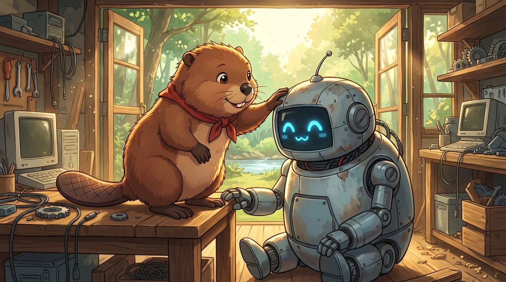
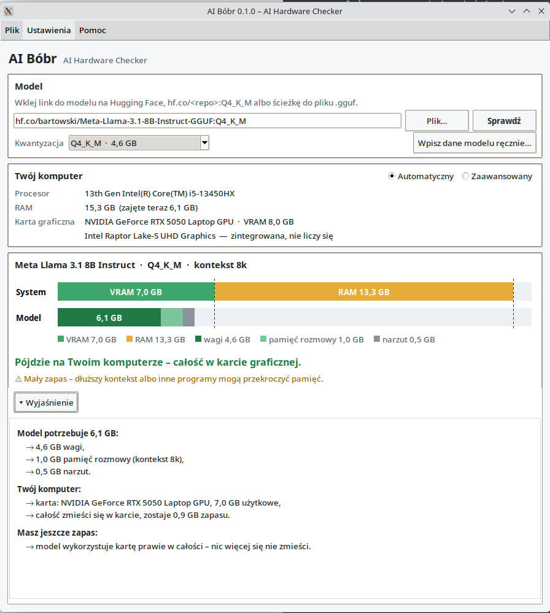

[](assets/banner.jpg)

# AI Bóbr (AI BEAVER)

**AI Hardware Checker** – will this local LLM run on my PC, and how fast?
*Czy ten lokalny model językowy pójdzie na moim komputerze i jak szybko?*

**[English](#english) · [Polski](#polski)**

> ⭐ **Like it? Leave a star** – it means a lot to the author and helps further work.
> ⭐ **Podoba się? Zostaw gwiazdkę** – to dla autora dużo znaczy i pomaga w dalszych pracach.

<p align="center"></p>
<p align="center"><sub>Llama 3.1 8B (Q4_K_M) on a laptop with an RTX 5050 8 GB: fits, but with a small margin. / Llama 3.1 8B na laptopie z RTX 5050 8 GB: mieści się, ale na styk.</sub></p>

---

## English

### What is it?

You want to try a model in Ollama, LM Studio or Jan, and you hit a wall of terms: VRAM,
Q4_K_M, context, KV cache, MoE. AI Bóbr answers one question for **one specific model**:
does it fit, and where?

- **Pick a model:** a Hugging Face link, `hf.co/<repo>:Q4_K_M` (the same form as `ollama run`),
  a local `.gguf` file, or enter the numbers by hand. In Advanced mode also a model you already
  have in Ollama (**From Ollama…**).
- **It scans your PC:** CPU, RAM and graphics cards (NVIDIA, AMD, Intel; Linux and Windows).
- **You get a memory bar:** your fast VRAM and slower RAM against what the model needs –
  weights, chat memory (KV cache) and overhead.
  - 🟢 everything on the graphics card – full speed,
  - 🟡 part of it in RAM – slower (with the percentage that stays on the card),
  - 🔴 doesn't fit at all – and how much is missing.
- **"Explanation"** (one click, hidden by default) tells you in plain words what uses the
  memory and **what you can do**: a quantization, a context length or a KV-cache setting that
  actually changes the verdict, or a smaller model from the built-in list that fits.

It reads only the header of the model file – a few MB, not gigabytes – so checking a 40 GB
model from Hugging Face takes seconds. Nothing is downloaded or installed.

### Quick start

**Windows:** download `AI-Bobr.exe` from [Releases](https://github.com/DarkZachi83/Bobr/releases)
and run it. The file isn't code-signed, so Windows SmartScreen may show
*"Windows protected your PC"* – click **More info → Run anyway**. `AI-Bobr-cli.exe` is the
same program for the command line.

**Linux** (and Windows from source) – Python 3.10+ with tkinter
(Arch: `pacman -S python tk`, Debian/Ubuntu: `apt install python3-tk`):

```
git clone https://github.com/DarkZachi83/Bobr.git && cd Bobr
pip install -r requirements.txt        # psutil; optional: nvidia-ml-py
python main.py                          # window
```

**macOS:** not supported yet – the program starts, but you have to enter RAM and VRAM by hand
(Advanced mode). Apple Silicon's unified memory needs its own rules, and we can't test them yet.

### Text mode

```
python main.py --cli hf.co/bartowski/Meta-Llama-3.1-8B-Instruct-GGUF:Q4_K_M --explain
python main.py --cli ~/models/qwen3-14b-Q4_K_M.gguf --context 16k
python main.py --cli <model> --vram 16 --ram 32      # "what if I buy a 16 GB card?"
python main.py --help
```

```
  System [=================---------------------------------]
  Model  [###########+++:                                   ]
  = VRAM 7.0 GB  - RAM 13.3 GB  # weights 4.6 GB  + chat memory 1.0 GB  : overhead 0.5 GB

>> It will run on your computer – entirely on the graphics card.
!  Small margin – a longer context or other programs may exceed the memory.
```

### How the memory is counted

```
needed = weights + KV cache + overhead
KV cache = 2 × layers × KV heads × head size × context × bytes per element
```

- **Weights:** the real file size (Hugging Face or your `.gguf`); for hand-entered models,
  bits per weight from `data/quants.json` (marked as an estimate).
- **KV cache:** from the model's architecture; grows with context. 8B at 8k ≈ 1 GB, at 32k ≈ 4 GB.
- **Usable memory:** VRAM minus 1 GB per card, RAM minus 2 GB (Linux) / 4 GB (Windows) for the system.
  Changeable in Advanced mode.
- **MoE models** (e.g. Qwen3-30B-A3B) must fit entirely, but use only part of the parameters per
  word, so they stay usable even partly in RAM. The program then suggests LM Studio's
  *"Force Model Expert Weights onto CPU"* or llama.cpp's `--cpu-moe`.

### Limits – read before you trust the number

- It's a **calculation, not a measurement**. The runtime overhead (0.5 GB) was calibrated on real
  runs (Ollama, RTX 5050 8 GB, models 3–14B: 17/17 verdicts right, never below nvidia-smi); much
  bigger models may need more. Like llama.cpp, the vocabulary table is counted in RAM, not on the card.
- **Speech models** (Orpheus, OuteTTS) are recognised by their audio tokens; Orpheus's audio decoder
  (SNAC) was measured at 0.22 GB, OuteTTS's is still an estimate.
- **Sliding-window models** (Gemma 3, gpt-oss) keep only recent tokens in most layers – this is
  counted for known architectures (llama.cpp rules); unknown ones get the full, safer estimate.
- A card with a lot of VRAM isn't always usable: very old NVIDIA cards, older drivers, and AMD/Intel
  cards that depend on the runtime get a warning next to the bar.
- Windows: the current VRAM usage of AMD/Intel cards isn't shown (it doesn't affect the verdict).

### Image models (preview)

Single-file checkpoints (`.safetensors` – SD 1.5, SDXL, Illustrious, Pony), diffusers folders
and repositories, and FLUX/SD 3 (also as GGUF) are checked by **the peak of the heaviest stage**
(prompt encoding → drawing → decoding), because Forge, ComfyUI and SD.Next move parts between RAM
and the card. Native resolution by default, `--resolution 1024x768` / `--batch 2` to change.
The compute memory per megapixel is still an **estimate** until it's measured.

### Models on your disk

**Models on disk…** (or `--scan [FOLDER]`) lists the models you already have – from Ollama,
LM Studio, the Hugging Face cache, llama.cpp and GPT4All, or from any folder you pick (e.g. Stable
Diffusion or ComfyUI). It asks first, reads only file names, sizes and headers, never opens pickle
files (`.ckpt`) and sends nothing anywhere. Text models can be checked with one double-click.

### Model list

Suggestions like *"the model X in Q4_K_M fits entirely"* come from `data/models/catalog.json`
(15 popular models from Llama 3.2 3B to Llama 3.3 70B). **Settings → Check for model list
updates** (or `--update-catalog`) downloads a newer list from this repository – the program
never connects to the internet on its own. The model you check always comes from your link or file.

### For developers

```
python -m unittest discover -s tests -t .     # GUI tests run when a display exists
python tools/try_source.py <link or .gguf>    # what the program reads from a model
python tools/try_detection.py [--json]        # what it detects on this PC (JSON = test profile)
python tools/calibrate.py                     # predictions vs. real memory use in Ollama
python main.py --fake-hw tests/fake_hardware/windows_amd_rx7900xtx.json   # pretend hardware
python tools/build_catalog.py                 # rebuild the model list from catalog_sources.txt
python tools/build_exe.py                     # PyInstaller build (CI does this for v* tags)
```

Design decisions are in [docs/SPEC.md](docs/SPEC.md) (in Polish). Settings you change and your
Hugging Face token are stored outside the repository (`~/.config/ai-bobr/`,
`%APPDATA%\AI-Bobr\`).

### How it was made

AI Bóbr was designed by Rafał (idea, decisions, testing on real hardware) together with
**Claude (Anthropic)** as an AI pair-engineer (code, tests, documentation) – the same team as
[NIUCHACZ](https://github.com/DarkZachi83/NIUCHACZ-POST-Code-Sniffer-), whose architecture it follows.

### Like it?

If AI BEAVER saved you a download that would never have fit – **leave a ⭐ star** at the top of this
page. It means a lot to the author and helps decide what comes next (speech, image and music models
are on the way). Found a wrong verdict? [Open an issue](https://github.com/DarkZachi83/Bobr/issues)
with the model link and what your program really used – real measurements make the tool better for everyone.

### License

[MIT](LICENSE).

---

## Polski

### Co to jest?

Chcesz uruchomić model w Ollamie, LM Studio albo Janie i trafiasz na ścianę pojęć: VRAM,
Q4_K_M, kontekst, cache KV, MoE. AI Bóbr odpowiada na jedno pytanie dla **konkretnego modelu**:
czy się zmieści i gdzie?

- **Wskazujesz model:** link do Hugging Face, `hf.co/<repo>:Q4_K_M` (ta sama forma co w
  `ollama run`), plik `.gguf` z dysku albo dane wpisane ręcznie. W trybie Zaawansowanym także
  model, który masz już w Ollamie (**Z Ollamy…**).
- **Program sprawdza komputer:** procesor, RAM i karty graficzne (NVIDIA, AMD, Intel; Linux i Windows).
- **Dostajesz pasek pamięci:** szybki VRAM i wolniejszy RAM obok tego, czego potrzebuje model –
  wag, pamięci rozmowy (cache KV) i narzutu.
  - 🟢 całość w karcie graficznej – pełna prędkość,
  - 🟡 część w RAM – wolniej (z procentem, który zostaje w karcie),
  - 🔴 nie mieści się wcale – i ile brakuje.
- **„Wyjaśnienie”** (jedno kliknięcie, domyślnie zwinięte) mówi prostymi słowami, co zajmuje
  pamięć i **co możesz zrobić**: kwantyzację, długość kontekstu albo ustawienie cache KV, które
  naprawdę zmieniają werdykt, albo mniejszy model z wbudowanej listy, który się zmieści.

Program czyta tylko nagłówek pliku modelu – kilka MB, nie gigabajty – więc sprawdzenie modelu
40 GB z Hugging Face trwa kilka sekund. Nic nie jest pobierane ani instalowane.

### Szybki start

**Windows:** pobierz `AI-Bobr.exe` z [Releases](https://github.com/DarkZachi83/Bobr/releases)
i uruchom. Plik nie ma płatnego podpisu, więc Windows SmartScreen może pokazać
„System Windows ochronił ten komputer” – kliknij **Więcej informacji → Uruchom mimo to**.
`AI-Bobr-cli.exe` to ten sam program do wiersza poleceń.

**Linux** (i Windows ze źródeł) – Python 3.10+ z tkinterem
(Arch: `pacman -S python tk`, Debian/Ubuntu: `apt install python3-tk`):

```
git clone https://github.com/DarkZachi83/Bobr.git && cd Bobr
pip install -r requirements.txt        # psutil; opcjonalnie: nvidia-ml-py
python main.py                          # okno
```

**macOS:** jeszcze nieobsługiwany – program się uruchomi, ale RAM i VRAM trzeba wpisać ręcznie
(tryb Zaawansowany). Pamięć zunifikowana Apple Silicon wymaga własnych reguł, których na razie
nie możemy sprawdzić.

### Tryb tekstowy

```
python main.py --cli hf.co/bartowski/Meta-Llama-3.1-8B-Instruct-GGUF:Q4_K_M --explain
python main.py --cli ~/modele/qwen3-14b-Q4_K_M.gguf --context 16k
python main.py --cli <model> --vram 16 --ram 32      # „a gdybym kupił kartę 16 GB?”
python main.py --help
```

### Jak liczymy pamięć

```
potrzeba = wagi + cache KV + narzut
cache KV = 2 × warstwy × głowice KV × wymiar głowicy × kontekst × bajty na element
```

- **Wagi:** prawdziwy rozmiar pliku (z Hugging Face albo Twojego `.gguf`); przy wpisie ręcznym –
  bity na wagę z `data/quants.json` (oznaczone jako szacunek).
- **Cache KV:** z architektury modelu; rośnie z kontekstem. 8B przy 8k ≈ 1 GB, przy 32k ≈ 4 GB.
- **Pamięć użytkowa:** VRAM minus 1 GB na kartę, RAM minus 2 GB (Linux) / 4 GB (Windows) dla
  systemu. Do zmiany w trybie Zaawansowanym.
- **Modele MoE** (np. Qwen3-30B-A3B) muszą się zmieścić w całości, ale przy każdym słowie używają
  tylko części parametrów, więc częściowo w RAM nadal są używalne. Program podpowiada wtedy
  „Force Model Expert Weights onto CPU” w LM Studio albo `--cpu-moe` w llama.cpp.

### Ograniczenia – przeczytaj, zanim zaufasz liczbie

- To **obliczenie, a nie pomiar**. Narzut runtime'u (0,5 GB) skalibrowaliśmy na prawdziwych
  uruchomieniach (Ollama, RTX 5050 8 GB, modele 3–14B: 17/17 trafionych werdyktów, ani razu poniżej
  nvidia-smi); dużo większe modele mogą potrzebować więcej. Tablicę słownika liczymy – jak
  llama.cpp – w RAM, nie w karcie.
- **Modele mowy** (Orpheus, OuteTTS) program rozpoznaje po tokenach dźwięku; dekoder Orpheusa
  (SNAC) zmierzyliśmy – 0,22 GB, dla OuteTTS to na razie szacunek.
- **Modele z oknem przesuwnym** (Gemma 3, gpt-oss) trzymają w większości warstw tylko ostatnie
  tokeny – dla znanych architektur liczymy to według reguł llama.cpp, dla nieznanych pełny,
  bezpieczniejszy szacunek.
- Duży VRAM nie zawsze znaczy, że runtime go użyje: bardzo stare karty NVIDIA, starsze sterowniki
  i karty AMD/Intel zależne od runtime'u dostają ostrzeżenie obok paska.
- Windows: bieżące zajęcie VRAM kart AMD/Intel nie jest pokazywane (nie wpływa na werdykt).

### Modele obrazów (wersja wstępna)

Pliki „wszystko w jednym” (`.safetensors` – SD 1.5, SDXL, Illustrious, Pony), foldery i repozytoria
diffusers oraz FLUX/SD 3 (także w GGUF) program ocenia po **szczycie najcięższego etapu**
(kodowanie opisu → rysowanie → dekodowanie), bo Forge, ComfyUI i SD.Next przenoszą części między RAM
a kartą. Domyślnie rozdzielczość natywna, zmiana: `--resolution 1024x768`, `--batch 2`. Pamięć
obliczeń na megapiksel to na razie **szacunek** – do czasu pomiaru.

### Modele na dysku

**Modele na dysku…** (albo `--scan [FOLDER]`) pokazuje modele, które już masz – z Ollamy, LM Studio,
pamięci podręcznej Hugging Face, llama.cpp i GPT4All albo ze wskazanego folderu (np. Stable Diffusion,
ComfyUI). Najpierw pyta o zgodę, czyta tylko nazwy, rozmiary i nagłówki plików, nigdy nie otwiera plików
pickle (`.ckpt`) i nic nie wysyła. Model tekstowy sprawdzisz dwuklikiem.

### Lista modeli

Podpowiedzi typu „model X w Q4_K_M zmieści się w całości” pochodzą z `data/models/catalog.json`
(15 popularnych modeli od Llamy 3.2 3B do Llamy 3.3 70B). **Ustawienia → Sprawdź aktualizacje listy
modeli** (albo `--update-catalog`) pobiera nowszą listę z tego repozytorium – program nigdy nie łączy
się z internetem sam z siebie. Sprawdzany model zawsze pochodzi z Twojego linku albo pliku.

### Dla programistów

Polecenia jak w części angielskiej (testy, `tools/try_source.py`, `tools/try_detection.py`,
`--fake-hw`, `tools/build_catalog.py`, `tools/build_exe.py`). Decyzje projektowe:
[docs/SPEC.md](docs/SPEC.md). Zmienione ustawienia i token Hugging Face są zapisywane poza
repozytorium (`~/.config/ai-bobr/`, `%APPDATA%\AI-Bobr\`).

### Jak powstał

AI Bobra zaprojektował Rafał (pomysł, decyzje, testy na prawdziwym sprzęcie) razem z
**Claude (Anthropic)** jako partnerem-inżynierem AI (kod, testy, dokumentacja) – ten sam zespół co
[NIUCHACZ](https://github.com/DarkZachi83/NIUCHACZ-POST-Code-Sniffer-), którego architekturę przejmuje.

### Podoba się?

Jeśli AI Bóbr oszczędził Ci pobierania modelu, który i tak by się nie zmieścił – **zostaw ⭐ gwiazdkę**
u góry tej strony. To dla autora dużo znaczy i pomaga zdecydować, co dalej (w drodze są modele mowy,
obrazów i muzyki). Werdykt się nie sprawdził? [Zgłoś to](https://github.com/DarkZachi83/Bobr/issues)
z linkiem do modelu i tym, ile pamięci naprawdę zajął – prawdziwe pomiary ulepszają program dla wszystkich.

### Licencja

[MIT](LICENSE).
